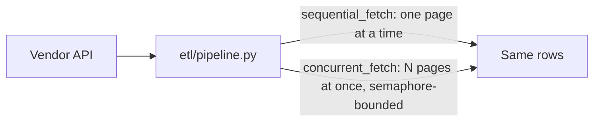

🟡 Portfolio demo, runnable locally, not deployed

# data-etl-demo

Concurrent-fetch extraction for offset-paginated APIs, with a benchmark that measures the actual speedup instead of just claiming one. One piece of a small multi-service platform demo, see [Related repos](#related-repos) for the rest.

This is a sanitized, generic rebuild for portfolio purposes. No real vendor, client, or company data is used anywhere in this repo. More context: [paulocremas-showcase](https://github.com/paulocremas-showcase). Full portfolio: [paulocremas.github.io](https://paulocremas.github.io). Built to the standard defined in my [Constitution](https://github.com/paulocremas/paulocremas-method).

## Table of contents
- [What this is](#what-this-is)
- [Flow](#flow)
- [Running it](#running-it)
- [Design notes](#design-notes)
- [Rules](#rules)
- [Related repos](#related-repos)

## What this is

The concurrent-fetch sibling to [data-extraction-demo](https://github.com/paulocremas-showcase/data-extraction-demo)'s sequential cursor approach. When an API's pagination is offset-based (page N's request doesn't depend on page N-1's response), every page's request can be computed up front and fired concurrently instead of one at a time. `etl/benchmark.py` measures this directly rather than asserting it.

## Flow



1. [etl/mock_source.py](etl/mock_source.py) simulates a real API's network latency so the timing comparison means something without needing a live server.
2. [etl/pipeline.py](etl/pipeline.py) has both `sequential_fetch()` and `concurrent_fetch()` against the same source, so they're directly comparable and testably return identical rows.
3. [etl/benchmark.py](etl/benchmark.py) runs both and prints the measured speedup.
4. [etl/api_client.py](etl/api_client.py) is the real async HTTP client version, semaphore-bounded concurrency, for pointing at an actual API instead of the mock.

## Running it

```
python3 -m venv .venv && source .venv/bin/activate
pip install -r requirements.txt

python -m etl.benchmark --total-items 6000 --page-size 100 --latency-ms 50 --max-concurrent 20
```

On this machine that prints:

```
60 pages, 50ms simulated latency per page
sequential:  3.03s
concurrent:  0.16s  (max_concurrent=20)
speedup:     19.4x
```

Smoke tests: `python tests/test_pipeline.py`

## Design notes

- **Speedup is bounded by `max_concurrent`, not free.** With latency dominating over local compute, concurrent fetch time approaches `sequential_time / max_concurrent`. This isn't a magic trick, it's trading request concurrency for wall-clock time, bounded by whatever rate limit the API actually allows.
- **This only works when pagination is offset-computable ahead of time.** If a page's request depends on the previous page's response (cursor-based pagination, or a filter that isn't ID-ordered on the server), concurrent fetching doesn't help and can actively hurt: I measured this exact failure mode on a real production API where an unindexed filter forced the server to re-scan per page, making concurrent fetching 1.6 to 2.8x **slower**, not faster. Know which shape of API you have before reaching for this.
- **Correctness before speed.** The test suite asserts `sequential_fetch` and `concurrent_fetch` return identical rows, the same check I ran against real production data before switching a live pipeline over to this pattern.

## Rules

- `sequential_fetch` and `concurrent_fetch` must always be tested for identical output, not just similar timing.
- The benchmark numbers in this README must come from actually running `etl/benchmark.py`, not be hand-written.
- No real vendor, client, or company names or data anywhere in this repo.

## Related repos

- [data-extraction-demo](https://github.com/paulocremas-showcase/data-extraction-demo) — the sequential, resumable-cursor variant of the same problem
- [inventory-sync-demo](https://github.com/paulocremas-showcase/inventory-sync-demo) — the push/sync direction instead of pull
- [ai-enrichment-demo](https://github.com/paulocremas-showcase/ai-enrichment-demo) — enriches records after they land
- [ops-dashboard-demo](https://github.com/paulocremas-showcase/ops-dashboard-demo) — monitors all of the above for schedule collisions
